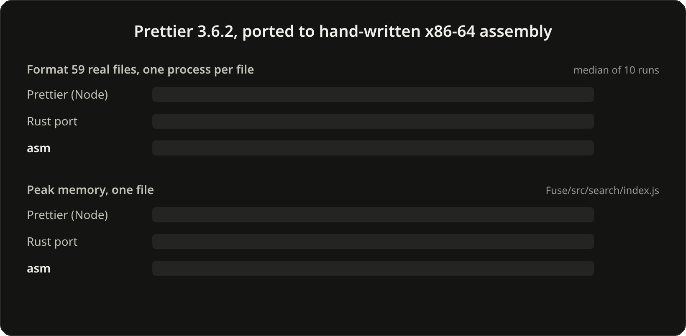

# prettier-asm

> This is not a serious project. For real formatting, use [Prettier](https://prettier.io).

Prettier 3.6.2, ported to hand-written x86-64 assembly. Yes, for real.



## Why?

[rust-anything](https://github.com/erkamyaman/rust-anything) ported Prettier to Rust and
measured it 18x faster on 59 real files. Rust is great, but if we are rewriting everything in
everything, why stop at Rust?

So this is Prettier as one static Linux binary. No libc. No allocator: memory is requested once
and never given back. It talks to the kernel with raw syscalls. The output is byte-identical to
Prettier's, or the binary refuses the file.

Claude wrote it, through Claude Code: the assembly, the tests, the benchmark and this README. I
picked the target, said "keep going" and reviewed. I am not that patient.

## Numbers

The same benchmark as the Rust port's headline: the 59 JS and TS source files of ms, Fuse.js and
json-server, one process per file, every output compared byte for byte with Prettier before
timing. Median of 10 runs on an i9-13900K under Linux:

| | Total | Per file | Speedup |
| --- | ---: | ---: | ---: |
| Prettier 3.6.2 (Node 22) | 4.36 s | 66.9 ms | 1x |
| Rust port, built here from their repo | 0.215 s | 2.85 ms | 20x |
| prettier-asm | 0.081 s | 1.26 ms | 54x |

59 of 59 files match. Starting 59 processes that do nothing takes 0.054 s on this machine, so
about a third of the 0.081 s is formatting. The rest is Linux.

[RESULTS.md](RESULTS.md) has every measurement: the environment, each file's time, the spread
between runs, syscall counts, memory, the Rust port's own benchmark script with asm added, and
what was not tested. `results/data/` has the raw numbers behind it.

## What it formats

- JavaScript in `.js`, `.mjs` and `.cjs` files
- TypeScript in `.ts`, `.mts` and `.cts` files
- JSON in `.json`, `.jsonc` and `.json5` files, and `package.json`

Prettier covers many more languages, and the Rust port covers ten. This covers the ones the
benchmark needs, plus JSON.

## What it refuses

When the binary cannot be sure of matching Prettier, it prints `unsupported: <reason>` and exits
3. It does not guess. Refused on purpose: JSX and TSX, Flow, most syntax proposals, embedded CSS,
GraphQL, HTML and Markdown in template literals, non-ASCII identifiers, and TypeScript input
where Prettier's two TypeScript parsers disagree.

On Prettier's own test fixtures that is a real share of the input:

| List | Cases Prettier formats | Identical | Refused | Different |
| --- | ---: | ---: | ---: | ---: |
| 59 real files | 59 | 59 | 0 | 0 |
| TypeScript fixtures | 536 | 492 | 44 | 0 |
| JavaScript fixtures | 879 | 654 | 225 | 0 |
| Fixtures under six option sets | 1,104 | 894 | 210 | 0 |
| JSON | 1,019 | 1,018 | 1 | 0 |

Set `PRETTIER_ASM_FALLBACK` to the path of `prettier.cjs` and a refused file is handed to Node
instead, at Node's speed.

## Build and use

Linux on x86-64, GNU `as` and `ld`. Nothing else.

```sh
make
build/prettier-asm path/to/file.ts
build/prettier-asm --stdin-filepath path/to/file.ts < file.ts
```

It reads `.prettierrc` (JSON or simple YAML), the `prettier` key of `package.json`,
`.editorconfig`, `.prettierignore` and `.gitignore`, and takes the common format options on the
command line. [docs/internals.md](docs/internals.md) lists them, along with the config formats
that are refused.

## How it is tested

The oracle is Prettier 3.6.2 from npm. Nothing counts unless the bytes match.

- 4,262 recorded cases: the 59 real files, Prettier's JS, TypeScript and JSON fixtures, and
  fixtures under option variants. 0 differ.
- An option sweep: every JS and TS case under 19 option sets, 22,895 identical outputs, 0 differ.
- Layer tests against Prettier's own internals: the parser against Babel's AST, comment
  attachment, the doc printer against `printDocToString`, and config file lookup.
- Mutation tests: the scripts break the assembly on purpose and check that the tests notice.
  RESULTS.md has the counts, survivors included.

A recorded test only covers what the recording reaches. Inserting comments at random positions
into TypeScript that already passed found 246 inputs where Prettier's own two TypeScript parsers
print differently. Those positions are refused now.

```sh
npm install
bench/build-rust-baseline.sh build # clones Prettier and rust-anything into ref/, builds the Rust port
node tests/setup-corpus.mjs        # the 59 real files and the fixture lists
node tests/build-expected.mjs      # Prettier's output for every case
make test
```

[tests/README.md](tests/README.md) has the rest, and RESULTS.md ends with the steps to reproduce
the benchmark.

## Is the assembly really hand-written?

No compiler produced it. The 76 files in `src/` are assembly source for GNU `as`, about 52,000
lines, written as assembly by Claude, function by function after Prettier's JavaScript. Two
files are data tables that scripts in `tests/` generate from Prettier's and Babel's own data:
`unicode_tables.s` (character widths) and `ast_types.s` (node type names and fields), 6,754
lines together. Their generators are checked in.

## Should you use this?

No. Use Prettier. This runs on exactly one CPU architecture and one operating system, it refuses
a quarter of Prettier's JavaScript fixtures, and nobody can maintain it, including me.

Was it fun? Quite a bit!

## License

MIT. The printer follows Prettier's source file by file, so Prettier's copyright notice is kept
in [LICENSE](LICENSE). The benchmark files, fixture lists and Rust baseline come from
rust-anything and Prettier, both MIT, and are fetched by the setup scripts, not stored here.
